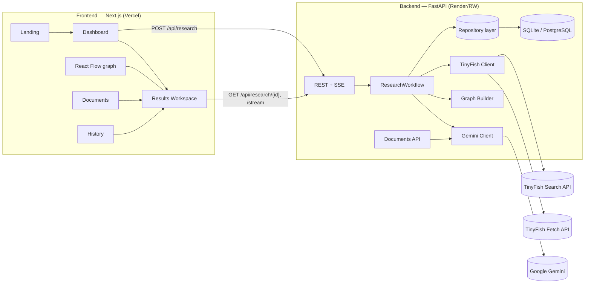

# Legal Buddy — Architecture

## Services

## Stage machine

Each session persists these stages (exactly what the UI renders):

`prepare → tinyfish_search → select → tinyfish_fetch → gemini → graph → done`

A stage can be `pending | running | completed | failed | skipped`. Session status
is `pending | running | completed | partial | failed`:

- `partial` — sources were fetched but analysis failed, or some fetches failed
- `failed` — nothing usable was retrieved (e.g., missing credentials)

No stage is ever marked complete before it actually succeeds.

## Data model

- `research_sessions` — question, jurisdiction, topic, stages, search/fetch steps,
  analysis JSON, graph JSON, usage JSON, timestamps
- `sources` — one row per search hit: URL, title, type, authoritative label,
  fetch status/error, retrieved markdown, excerpts, provider metadata, rank
- `documents` — uploaded PDFs (metadata + preview only; raw file not persisted)
- `usage` — per-session counters feeding `/api/usage/summary` (cost estimates)

Repository layer (`app/repositories/`) isolates SQLAlchemy so SQLite can be
swapped for PostgreSQL by changing `DATABASE_URL` and connection args.

## Security

- SSRF guard (`app/core/security.py`): only http(s), blocks localhost,
  private ranges, metadata endpoints; applied before every fetch.
- Uploaded PDFs: extension + magic-bytes + size checks, encryption rejected,
  page/text caps. Files are processed in-memory, never written to disk.
- Rate limiter: sliding window per client IP on research/docs endpoints.
- CORS locked to `FRONTEND_ORIGIN`.
- Prompt-injection scanning of retrieved text (advisory) + strict system/source
  separation in the Gemini prompt.
- Secrets only in backend env vars; `/api/integrations/status` reports
  `configured: true/false`, never key values.

## Honest-evidence rules

1. Every takeaway/provision/entity/relationship carries `source_ids` validated
   against actually-fetched sources; unknown IDs are dropped.
2. `OVERRULES`/`DISTINGUISHES` are auto-downgraded to `RELATED_TO`
   (`uncertain`) unless the evidence excerpt explicitly uses those words.
3. Fetch failures are persisted per-source with the provider's error.
4. Disclaimer string is attached to every session and displayed in the UI.

## Deployment

- **Frontend**: Vercel, `cd frontend && npm run build`. Set
  `NEXT_PUBLIC_API_BASE_URL` to the backend URL.
- **Backend**: Render/Railway, `cd backend && uvicorn app.main:app --host 0.0.0.0 --port $PORT`.
  Set `FRONTEND_ORIGIN` to the deployed frontend URL, plus `TINYFISH_API_KEY`
  and `GEMINI_API_KEY`. SQLite works for demo; use a managed Postgres URL for
  anything persistent (`DATABASE_URL=postgresql://...` needs `psycopg[binary]`
  added to requirements).